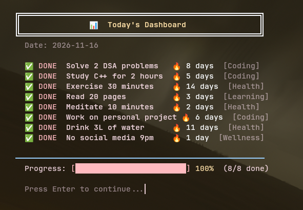
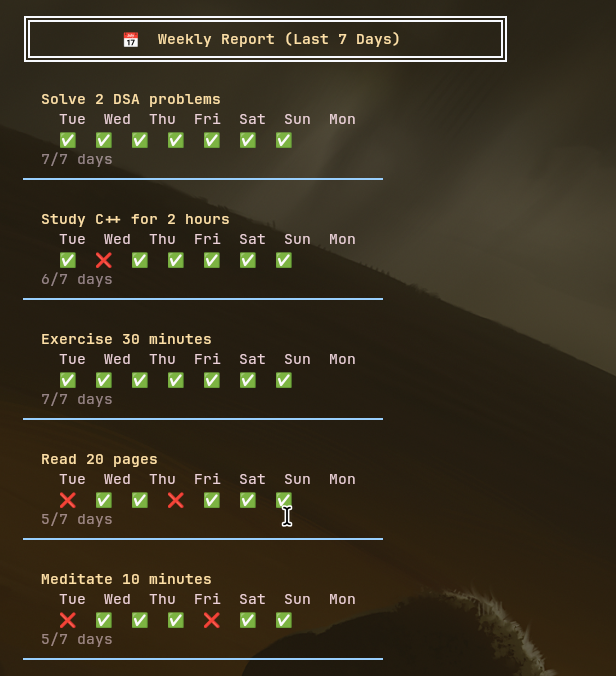
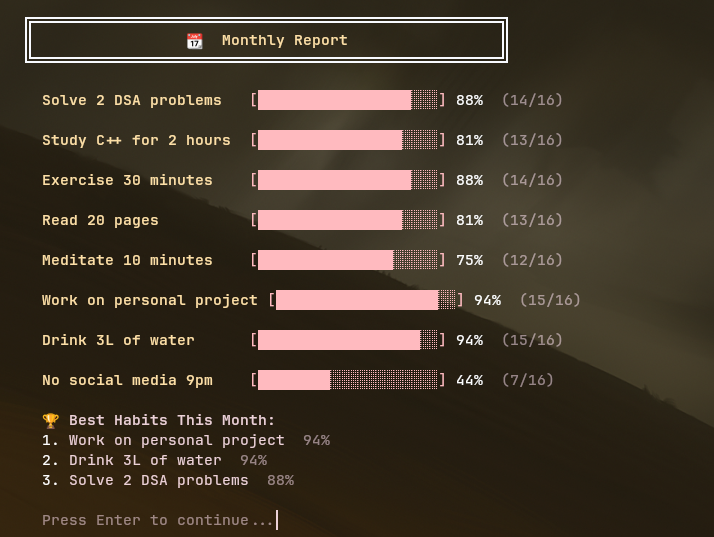

# 🌿 HabitLog

A full-featured, **C++17 terminal habit tracker** with a rich ANSI color UI, JSON persistence, weekly/monthly reports, streaks, and history.

---

## 📸 Screenshots

### 📊 Daily Dashboard
> At-a-glance status for today — habit completion, 🔥 streaks, and a progress bar.



---

### 📅 Weekly Report
> 7-day completion grid per habit with ✅ / ❌ for each day of the week.



---

### 📆 Monthly Report
> Completion percentage bars and a ranked leaderboard of your best habits.



---

## ✨ Features

- **Dashboard** – At-a-glance status for today: ✅/⬜ for each habit, 🔥 streak counters, and an overall progress bar
- **Habit CRUD** – Add, edit, delete, and archive habits with name, description, and category
- **Completion tracking** – Mark habits complete, undo, duplicate-prevention
- **Streaks** – Current and longest streak calculation per habit
- **Weekly Report** – 7-day grid with day labels (Mon/Tue/…) and ✅/❌ per habit
- **Monthly Report** – Completion percentage bar + ranked "best habits" leaderboard
- **History** – Last 30 days for any or all habits
- **JSON persistence** – Data stored in `~/.habitlog/` (habits.json + completions.json)

---

## 🛠 Build

### Prerequisites

- CMake ≥ 3.16
- GCC ≥ 9 or Clang ≥ 9 (C++17)

### Steps

```bash
git clone https://github.com/dipak-01/HabitLog.git
cd HabitLog
mkdir -p build && cd build
cmake .. -DCMAKE_BUILD_TYPE=Release
make -j$(nproc)
```

The executable is at `build/habitlog`.

---

## 🚀 Usage

Launch interactive mode:
```bash
./build/habitlog
```

Command line flags:
```bash
./build/habitlog --help       # Display help and options
./build/habitlog --version    # Print version information
```

Navigate the numbered menu:

| Option | Action |
|--------|--------|
| 1 | Dashboard |
| 2 | List All Habits |
| 3 | Mark Habit Complete |
| 4 | Undo Completion |
| 5 | Add New Habit |
| 6 | Edit Habit |
| 7 | Delete Habit |
| 8 | Archive Habit |
| 9 | Weekly Report |
| 10 | Monthly Report |
| 11 | History |
| 0 | Quit |

---

## 🧪 Tests

```bash
cd build
./test_habits
```

Runs assertions for: add habit, mark complete, duplicate prevention, undo, streak calculation, edit, delete.

---

## 📂 File Structure

```
HabitLog/
├── CMakeLists.txt
├── README.md
├── .gitignore
├── third_party/
│   └── nlohmann/json.hpp        # JSON parser (header-only)
├── include/
│   ├── models/Habit.h           # Habit & Completion structs
│   ├── services/HabitManager.h  # CRUD + streak logic
│   ├── services/Statistics.h    # Reporting engine
│   ├── storage/JsonStorage.h    # JSON file I/O
│   └── ui/TerminalUI.h          # Terminal UI (ANSI)
├── src/
│   ├── main.cpp
│   ├── models/Habit.cpp
│   ├── services/HabitManager.cpp
│   ├── services/Statistics.cpp
│   ├── storage/JsonStorage.cpp
│   └── ui/TerminalUI.cpp
├── data/                        # Seed/template JSON files
│   ├── habits.json
│   └── completions.json
└── tests/
    └── test_habits.cpp          # assert()-based unit tests
```

---

## 📦 Data Storage

All user data lives in `~/.habitlog/`:

| File | Contents |
|------|----------|
| `habits.json` | Array of habit objects |
| `completions.json` | Array of completion records |

---

## 📄 License

MIT
